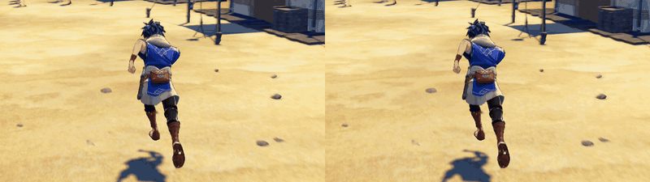
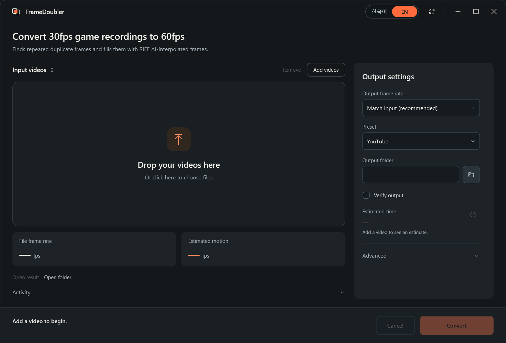
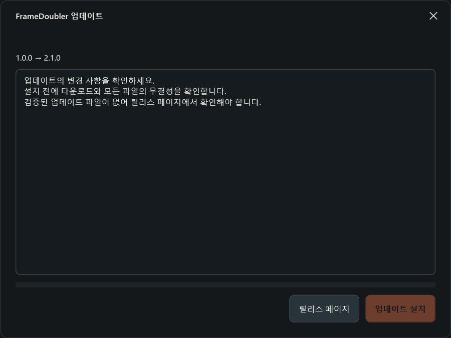

<p align="center">
  
</p>
<h1 align="center">FrameDoubler</h1>
<p align="center">
  <a href="https://github.com/deuxdoom/FrameDoubler/releases/latest"></a>
  <a href="https://github.com/deuxdoom/FrameDoubler/releases"></a>
  
  <a href="LICENSE"></a>
</p>

<p align="center">
  
  
  
</p>

<p align="center"><b>30fps 게임 녹화 영상을 실제 60fps로 바꾸는 Windows용 프레임 보간 프로그램</b><br>
60fps 파일 속의 중복 프레임을 찾아내고, RIFE AI로 사이의 프레임을 채웁니다.</p>

<p align="center">
  
</p>

<p align="center">
  <a href="https://deuxdoom.github.io/FrameDoubler/"></a>
</p>

<p align="center">
  <a href="#introduction"></a>
  <a href="#compare"></a>
  <a href="#features"></a>
  <a href="#screenshots"></a>
  <a href="#download"></a>
</p>
<p align="center">
  <a href="#usage"></a>
  <a href="#update"></a>
  <a href="#cli"></a>
  <a href="#development"></a>
  <a href="#licenses"></a>
</p>

---

<a id="introduction"></a>

## 📌 소개

콘솔 게임이 30fps로 동작하면 캡처 카드는 같은 화면을 두 번씩 받아 60fps 파일로 저장합니다. 파일 정보에는 60fps라고 표시되지만 실제 움직임은 30fps이므로, 유튜브에 올려도 60fps의 부드러움은 나오지 않습니다.

일반적인 보간 프로그램은 이 파일을 그대로 2배로 늘리기 때문에 똑같은 두 프레임 사이를 보간하게 됩니다. FrameDoubler는 먼저 **중복 프레임을 걷어 내어 실제 움직임을 복원**한 뒤에, 남은 프레임 사이를 [Practical-RIFE](https://github.com/hzwer/Practical-RIFE) 모델로 보간합니다.

```
녹화 원본      A  A  B  B  C  C      파일 60fps · 움직임 30fps
FrameDoubler   A  A½ B  B½ C  C½     파일 60fps · 움직임 60fps
```

<a id="compare"></a>

## 🎬 비교 영상

<p align="center">
  <b>◀ 원본 · 움직임 30fps</b>&emsp;&emsp;&emsp;&emsp;<b>FrameDoubler · 움직임 60fps ▶</b><br>
  
</p>

파이어엠블렘 만자천홍의 4K 녹화(60fps)에서 같은 구간을 0.42배 속도(초당 25프레임)로 재생하여 모든 프레임을 보여 줍니다. 왼쪽 원본은 같은 그림이 두 번씩 나오고, 오른쪽 결과는 프레임마다 움직입니다. 실제 속도의 비교는 [소개 페이지](https://deuxdoom.github.io/FrameDoubler/)에서 볼 수 있습니다.

<a id="requirements"></a>

## 💻 시스템 요구 사항

- Windows 11 64비트 (x64)
- Vulkan을 지원하는 GPU와 최신 드라이버 권장 (NVIDIA, AMD, Intel). 제조사나 모델명이 아니라 실제로 동작하는 기능을 확인하여 사용합니다.
- Vulkan을 쓸 수 없으면 CPU로 추론하고, 하드웨어 인코더가 없으면 소프트웨어 인코더를 사용합니다. 이 경우 크게 느려지며 화면에 표시합니다.
- 개발과 실제 검증은 RTX 4080 SUPER와 i7-14700KF에서 했습니다. 필수 사양은 아니며, 다른 제조사의 GPU와 복수 GPU는 아직 실제 장비로 검증하지 않았습니다([하드웨어 검사 절차](app/HARDWARE-TESTS.md)).
- SDR 영상 (HDR 입력은 아직 지원하지 않습니다)

<a id="features"></a>

## ✨ 주요 기능

### 🔍 입력과 장치 자동 분석

영상을 추가하면 해상도, 코덱, 비트레이트, 길이, 프레임레이트, CFR/VFR, 비트 심도, 색상 정보를 읽습니다. 1~2시간 길이의 녹화도 여러 구간만 읽어 바로 분석합니다. **파일 프레임레이트**와 **실제 움직임 프레임레이트**를 나란히 보여 주므로 이 영상이 어떤 파일인지 바로 알 수 있습니다. 시작할 때에는 이 PC의 CPU, GPU, Vulkan 기능, 인코더를 확인합니다.

### 🎞️ 중복 프레임 감지와 움직임 복원

- 압축 때문에 조금씩 달라진 중복 프레임도 판정합니다.
- 게임이 프레임을 놓쳐 3회, 4회 반복된 구간을 올바르게 처리합니다.
- 일시 정지 메뉴나 로딩 화면 같은 정지 화면은 보간하지 않고 그대로 둡니다.
- 29.97/30fps 원본, 59.94/60fps 파일, VFR 입력을 같은 방식으로 처리합니다.

### ⏱️ 예상 소요 시간

변환하기 전에 선택한 장치와 설정으로 짧게 실제 처리를 해 보고 예상 시간의 범위를 보여 줍니다. 대기열 전체의 합계도 함께 표시합니다. 같은 조건으로 끝낸 작업이 쌓이면 그 결과로 예상을 보정합니다. 장면, 저장 장치, 다른 프로그램의 부하에 따라 실제 시간은 달라질 수 있습니다.

### 🤖 RIFE AI 보간

- Practical-RIFE 4.25(기본값)와 4.26 모델을 ncnn과 Vulkan으로 실행합니다. 두 모델 모두 프로그램에 들어 있어 따로 내려받을 필요가 없습니다.
- 출력 프레임마다 정확한 시각의 프레임을 만들기 때문에 프레임 드롭 구간도 자연스럽게 채웁니다.
- 장면이 바뀌는 순간에는 보간하지 않아 두 화면이 섞인 프레임이 생기지 않습니다.
- 고정 HUD(미니맵, 자막) 영역을 지정하면 그 화소를 원본 그대로 유지합니다.

### 🎥 인코딩과 검증

- NVENC, AMF, QSV, 소프트웨어 인코더를 짧게 실제로 인코딩해 보고, 성공한 H.264·HEVC·AV1 조합만 메뉴에 보여 줍니다. 추론 GPU와 인코더는 서로 달라도 됩니다.
- **YouTube 프리셋**은 해상도와 fps에 맞는 권장 비트레이트의 MP4를 만듭니다. 화질을 우선하는 **품질 우선** 프리셋도 있습니다.
- 영상 길이, 오디오 시작 시각과 싱크, 색상 정보를 원본 그대로 유지합니다.
- `변환 후 검증`을 켜면 변환이 끝난 뒤 프레임레이트, 길이, 오디오 동기, 색상, 남은 중복 프레임 비율을 검사합니다. 기본으로는 꺼져 있으며, 켜면 예상 소요 시간에 검증 시간도 더해집니다.
- 보관용으로 119.88fps와 120fps 출력을 선택할 수 있습니다.

### 🧰 편의 기능

- 클릭, 끌어 놓기, `Ctrl+O`로 여러 영상을 추가하고 순서대로 처리하는 대기열
- 프레임리스 창(이동, 크기 조절, 최대화), 접어 둔 고급 설정과 처리 기록
- 창을 최소화하면 트레이에서 계속 실행 (창 열기, GitHub, 업데이트, 종료)
- 같은 이름의 결과 파일은 덮어쓰지 않으며, 취소하거나 실패하면 미완성 파일을 정리
- 한국어와 영어 화면

### 📊 실제 4K 녹화의 검증 결과

| 항목 | 결과 |
| --- | --- |
| 입력 | 파이어엠블렘 만자천홍 녹화, 3840×2160, 60fps, 1,283프레임, 약 21.39초 |
| 추정한 실제 움직임 | 29.81fps |
| 출력 | 60fps, 1,283프레임 (새로 만든 프레임 610장) |
| 남은 움직임 중복 | 0.48% (기준 1% 이하) |
| 길이 차이 / 최대 오디오 동기 변화 | 0ms / 6.83ms |
| 입력 중복 비율 | 50.31% (움직이는 프레임의 절반이 중복) |
| 처리 시간 | 변환만 약 157초, 변환과 검증 약 200초 (RTX 4080 SUPER, i7-14700KF) |

처리 시간과 결과는 영상의 내용과 장치에 따라 달라집니다.

<a id="screenshots"></a>

## 🖼️ 화면 모음

| 첫 화면 | 영어 화면 | 업데이트 |
| --- | --- | --- |
|  |  |  |

<a id="download"></a>

## 📥 내려받기와 실행

1. [최신 릴리스](https://github.com/deuxdoom/FrameDoubler/releases/latest)에서 `FrameDoubler.zip`(약 208MB)을 내려받습니다.
2. 원하는 위치에 압축을 풉니다. 풀린 `FrameDoubler` 폴더(약 460MB)는 통째로 유지합니다.
3. `FrameDoubler.exe`를 실행합니다.

.NET 런타임, RIFE 모델, FFmpeg가 모두 들어 있어 Python, CUDA Toolkit, 별도 SDK를 설치할 필요가 없습니다. GPU 드라이버는 포함하지 않습니다. 파일의 SHA-256은 릴리스 설명에 적혀 있습니다.

```powershell
Get-FileHash FrameDoubler.zip -Algorithm SHA256
```

> 아직 공개 릴리스는 없습니다. 개발 중의 빌드는 `pwsh scripts/build.ps1`로 만든 `dist/FrameDoubler/FrameDoubler.exe`입니다.

<a id="usage"></a>

## 🚀 사용 방법

1. 영상을 창에 끌어 놓거나 가운데 영역을 클릭합니다. `영상 추가`와 `Ctrl+O`도 사용할 수 있습니다. 추가하면 바로 분석합니다.
2. 파일 fps와 실제 움직임 fps를 확인하고, 목표 프레임레이트·프리셋·저장 폴더를 고릅니다. 저장 폴더를 비워 두면 원본과 같은 폴더에 저장합니다.
3. `예상 소요 시간`을 확인하고 `변환 시작`을 누릅니다. 끝나면 `결과 열기` 또는 `폴더 열기`를 누릅니다. 결과를 검사하려면 `변환 후 검증`을 켜 둡니다.

| 입력 | 기본 출력 (`입력에 맞춤`) |
| --- | --- |
| 29.97fps | 59.94fps |
| 30fps | 60fps |
| 59.94fps (움직임 30fps) | 59.94fps |
| 60fps (움직임 30fps) | 60fps |

추론 장치, 인코더, 코덱, RIFE 모델, 품질, 비트레이트, 고정 HUD 영역은 `고급 설정`에 있습니다. YouTube 프리셋은 60fps까지이며, 120fps 출력에는 `품질 우선` 프리셋을 사용합니다. 창을 닫으면 진행 중인 작업을 취소하고 정리한 뒤 종료합니다.

설정(`settings.json`), 성능 기록(`performance.json`), 작업 파일(`work`)은 모두 `FrameDoubler.exe`가 있는 폴더에 저장합니다. 폴더를 통째로 옮겨도 설정이 그대로 이어집니다.

<a id="update"></a>

## 🔄 업데이트

시작할 때 GitHub의 안정 릴리스를 확인하고, 새 버전이 있으면 제목 표시줄의 업데이트 버튼(⟳)에 표시합니다. 업데이트 창에서 변경 사항을 확인한 뒤 설치를 선택합니다. 트레이 메뉴의 `업데이트`로도 열 수 있습니다.

- `FrameDoubler.zip`에 GitHub가 제공하는 SHA-256이 있어야 하고, 릴리스 설명에 SHA-256이 적혀 있으면 서로 일치해야 합니다.
- 내려받은 뒤 패키지의 매니페스트와 모든 파일의 해시를 확인하고, 이전 설치를 보관한 상태에서 교체합니다. 설정과 성능 기록은 새 설치로 옮기며, 교체에 실패하면 이전 설치로 되돌립니다.
- 로컬 시험은 통과했으며, 실제 공개 릴리스를 통한 업데이트는 아직 검증하지 않았습니다.

<a id="cli"></a>

## ⌨️ 명령줄

같은 폴더의 `FrameDoubler.Cli.exe`는 화면과 같은 변환 과정을 사용합니다.

```text
FrameDoubler.Cli hardware                                   이 PC의 장치와 인코더
FrameDoubler.Cli analyze video.mp4                          형식, 비트레이트, 실제 움직임 fps
FrameDoubler.Cli estimate video.mp4 --preset youtube         예상 소요 시간 (--verify: 검증 포함)
FrameDoubler.Cli run -i video.mp4 -o smooth.mp4 --preset youtube
FrameDoubler.Cli run -i video.mp4 --device gpu:1 --encoder qsv --codec hevc
FrameDoubler.Cli run -i video.mp4 --device cpu --software --codec h264
FrameDoubler.Cli run -i video.mp4 --fps 120 --model v4.26
FrameDoubler.Cli verify video.mp4 smooth.mp4 --fps 60
FrameDoubler.Cli batch recordings -o converted --recursive
```

`--overwrite`는 기존 파일의 교체를 허용하고, `--no-verify`는 검증을 건너뜁니다(명령줄의 `run`은 기본으로 검증합니다). `--hud-region X,Y,W,H`는 여러 번 지정할 수 있으며, `--quality 1..51` 또는 `--bitrate 24M`으로 화질을 정합니다. 자세한 내용은 [실행 안내](app/README.md)에 있습니다.

<a id="development"></a>

## 🛠️ 개발 환경

Windows 11 x64, `global.json`의 .NET SDK(10.0.404)와 외부 CMake/Ninja·LLVM-MinGW·ncnn 소스를 사용합니다.

```powershell
pwsh scripts/setup-dev.ps1                                    # 빌드 도구 준비
dotnet run --project app/FrameDoubler.Tests                   # 테스트
pwsh scripts/build.ps1                                        # dist/FrameDoubler와 dist/FrameDoubler.zip 생성
```

빌드 도구와 중간 파일은 `F:/Temp/FrameDoubler`에 둡니다. 모델의 최초 변환과 수치 비교에만 필요한 최소 Python 코드는 [`poc/ncnn-rife`](poc/ncnn-rife/README.md)에 격리했으며 제품에는 포함하지 않습니다. 변경 내역은 [CHANGELOG.md](CHANGELOG.md), 개발 진행은 [PROGRESS.md](PROGRESS.md)에 있습니다.

<a id="licenses"></a>

## 📄 출처와 라이선스

FrameDoubler는 [MIT 라이선스](LICENSE)로 배포하는 독립 프로젝트입니다. Video2X와 Flowframes는 기술 분석의 참고 자료일 뿐이며, 소스 코드나 모델 자산을 복사하거나 이식하지 않았습니다.

- 프레임 보간: [Practical-RIFE](https://github.com/hzwer/Practical-RIFE)의 공식 가중치를 ncnn 형식으로 변환 (MIT, Copyright (c) 2021 hzwer)
- 추론: [Tencent ncnn](https://github.com/Tencent/ncnn) (BSD-3-Clause)과 glslang
- 앱: Microsoft .NET / Windows Desktop 런타임 (MIT)
- 디코딩과 인코딩: [FFmpeg](https://ffmpeg.org) (BtbN LGPL 빌드, 교체 가능한 별도 실행 파일)

구성 요소별 고지는 [THIRD_PARTY_NOTICES.md](THIRD_PARTY_NOTICES.md)에 있습니다. 비교 영상은 개발자가 직접 녹화한 게임 화면이며, 게임 화면의 저작권은 해당 권리자에게 있습니다.
