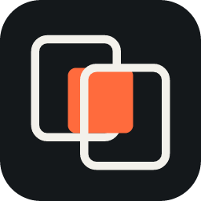

<p align="center">
  
</p>
<h1 align="center">FrameDoubler</h1>
<p align="center">
  <a href="https://github.com/deuxdoom/FrameDoubler/releases/latest"></a>
  <a href="https://github.com/deuxdoom/FrameDoubler/releases"></a>
  
  <a href="LICENSE"></a>
</p>

<p align="center">
  
  
  
  
</p>

<p align="center"><b>30fps 게임 녹화 영상을 실제 60fps로 바꾸는 Windows용 프레임 보간 프로그램</b><br>
60fps 파일 속의 중복 프레임을 찾아내고, RIFE AI로 사이의 프레임을 채웁니다.</p>

<p align="center">
  
</p>

<p align="center">
  <a href="https://deuxdoom.github.io/FrameDoubler/"></a>
</p>

<p align="center">
  <a href="#introduction"></a>
  <a href="#features"></a>
  <a href="#download"></a>
  <a href="#usage"></a>
  <a href="#update"></a>
  <a href="#development"></a>
  <a href="#licenses"></a>
</p>

---

<a id="introduction"></a>

## 📌 소개

콘솔 게임이 30fps로 동작하면 캡처 카드는 같은 화면을 두 번씩 받아 60fps 파일로 저장합니다. 파일 정보에는 60fps라고 표시되지만 실제 움직임은 30fps이므로, 유튜브에 올려도 60fps의 부드러움은 나오지 않습니다.

일반적인 보간 프로그램은 이 파일을 그대로 2배로 늘리기 때문에 똑같은 두 프레임 사이를 보간하게 됩니다. FrameDoubler는 먼저 **중복 프레임을 걷어 내어 실제 움직임을 복원**한 뒤에, 남은 프레임 사이를 [Practical-RIFE](https://github.com/hzwer/Practical-RIFE) 모델로 보간합니다.

```
녹화 원본      A  A  B  B  C  C      파일 60fps · 움직임 30fps
FrameDoubler   A  A½ B  B½ C  C½     파일 60fps · 움직임 60fps
```

<a id="requirements"></a>

## 💻 시스템 요구 사항

- Windows 11 64비트
- Intel 및 AMD x64 CPU, NVIDIA/AMD/Intel Vulkan GPU가 지원 대상입니다. 모델명보다 실제 기능·드라이버를 감지합니다.
- Vulkan 불가 시 ncnn CPU 추론을 사용합니다. CPU/소프트웨어 인코딩은 크게 느릴 수 있습니다.
- RTX 4080 SUPER + i7-14700KF는 개발 기준 장비이며 필수 사양이 아닙니다. 다른 실제 장비의 검증은 아직 대기 중입니다.
- 신규 패키지는 .NET 런타임과 모델을 포함하며 Python, CUDA Toolkit 또는 별도 SDK 설치가 필요하지 않습니다.
- SDR 영상 (HDR 입력은 아직 지원하지 않습니다)

<a id="features"></a>

## ✨ 주요 기능

### 🔍 입력 자동 분석

영상을 끌어다 놓으면 해상도, 코덱, 프레임레이트, CFR/VFR, 비트 심도, 색상 정보를 읽습니다. **파일의 프레임레이트**와 **추정한 움직임 프레임레이트**를 나란히 보여 주므로, 이 영상이 어떤 파일인지 바로 알 수 있습니다.

### 🎞️ 중복 프레임 감지와 움직임 복원

- 압축 때문에 조금씩 달라진 중복 프레임도 판정합니다.
- 게임이 프레임을 놓쳐 3회, 4회 반복된 구간을 올바르게 처리합니다.
- 일시 정지 메뉴나 로딩 화면 같은 정지 화면은 보간하지 않고 그대로 둡니다.
- 29.97/30fps 원본, 59.94/60fps 파일, VFR 입력을 같은 방식으로 처리합니다.

### 🤖 RIFE AI 보간

- Practical-RIFE v4.25(기본값)와 v4.26 모델을 지원합니다.
- 출력 프레임마다 정확한 시각의 프레임을 만들기 때문에 프레임 드롭 구간도 자연스럽게 채웁니다.
- 장면이 바뀌는 순간에는 보간하지 않아 두 화면이 섞인 프레임이 생기지 않습니다.
- 고정 HUD(미니맵, 자막) 영역을 지정하면 그 화소를 원본 그대로 유지합니다.

### 🎬 인코딩과 검증

- NVENC/AMF/QSV와 소프트웨어 인코더에서 실제 실행되는 H.264/HEVC/AV1·비트 심도 조합만 선택합니다.
- **YouTube 프리셋**은 해상도와 fps에 맞는 권장 비트레이트의 H.264 MP4를 만듭니다.
- 영상 길이, 오디오 싱크, 색상 정보를 원본 그대로 유지합니다.
- 변환이 끝나면 프레임레이트, 길이, 오디오, 남은 중복 프레임 비율을 검사합니다.
- 보관용으로 119.88fps와 120fps 출력을 선택할 수 있습니다.

### 🧰 편의 기능

- 여러 영상을 순서대로 처리하는 작업 대기열
- 창을 최소화하면 트레이에서 계속 실행 (메인 창 열기, 업데이트 확인, GitHub 저장소 열기, 종료)
- SHA-256 검증을 거치는 자동 업데이트
- 한국어와 영어 화면

<a id="download"></a>

## 📥 내려받기와 실행

로컬 테스트 빌드는 `dist/FrameDoubler/FrameDoubler.exe`입니다.
`dist/FrameDoubler.zip`을 다른 위치에 풀어 실행할 수도 있습니다.
폴더 전체를 유지하세요. .NET 런타임·모델·FFmpeg를 포함하며 Python/Torch 설치가 필요하지 않습니다.
크기와 실제 검증 범위는 [PROGRESS.md](PROGRESS.md), [하드웨어 검사 절차](app/HARDWARE-TESTS.md)에 있습니다.
현재 네이티브 버전의 공개 릴리스는 만들지 않았습니다.

<a id="usage"></a>

## 🚀 사용 방법

1. 파일을 끌어 놓거나 중앙 영역을 클릭합니다. `영상 추가`와 `Ctrl+O`도 사용할 수 있습니다.
2. 파일 fps와 실제 움직임 fps를 확인하고 출력 프레임레이트·프리셋·저장 위치를 선택합니다.
3. `변환 시작`을 누릅니다. 완료 후 검증 결과를 확인하고 결과 파일을 엽니다.

장치·인코더·코덱·모델·품질·HUD 옵션은 `고급 설정`에 있습니다.
처리 기록은 필요할 때 펼쳐 볼 수 있습니다. 같은 출력 파일은 기본적으로 보호합니다.
YouTube 프리셋은 60fps까지이며 120fps 출력에는 품질 우선 프리셋을 사용합니다.
기본 창은 프레임리스이며 제목 표시줄 이동·최대화/복원·크기 조절을 지원합니다.

설정은 `%APPDATA%/FrameDoubler/native-settings.json`에 저장합니다.
창 최소화 시 트레이로 이동하고, 닫기는 진행 작업을 취소한 뒤 종료합니다.
자세한 CLI 예시는 [실행 안내](app/README.md)를 참고하세요.

<a id="update"></a>

## 🔄 업데이트

안정 릴리스를 확인하고 사용자가 설치를 선택합니다. `FrameDoubler.zip`의 GitHub SHA-256과
네이티브 매니페스트·모든 파일 해시를 검사한 뒤 이전 설치를 백업하고 교체합니다.
교체 실패 시 이전 설치로 복구합니다. 구형 Torch 패키지는 설치하지 않습니다.
로컬 시험은 통과했으며 실제 공개 네이티브 릴리스 전체 갱신은 아직 검증하지 않았습니다.

<a id="development"></a>

## 🛠️ 개발 환경

Windows 11 x64, `global.json`의 .NET SDK와 외부 CMake/Ninja·LLVM-MinGW·ncnn 소스를 사용합니다.

```powershell
pwsh scripts/setup-dev.ps1
dotnet build app/FrameDoubler.App/FrameDoubler.App.csproj -c Release
dotnet run --project app/FrameDoubler.Tests/FrameDoubler.Tests.csproj
pwsh scripts/build.ps1
```

빌드 도구와 중간 파일은 `F:/Temp/FrameDoubler`에 두며 Torch/Qt/PyInstaller를 설치하지 않습니다.
빌드 입력인 FFmpeg 실행 파일과 변환된 ncnn 모델은 외부에서 준비합니다.
모델 최초 변환·수치 비교에만 필요한 최소 Python/Torch 코드는
[`poc/ncnn-rife`](poc/ncnn-rife/README.md)에 격리했습니다. 제품에는 포함하지 않습니다.
현재 테스트는 `app/FrameDoubler.Tests`와 GUI 진단 명령을 사용합니다.
제거한 구형 앱·테스트·도구 및 백업은 [정리 기록](app/CLEANUP.md)을 따릅니다.

<a id="licenses"></a>

## 📄 출처와 라이선스

FrameDoubler는 MIT 라이선스의 독립 앱입니다. 추론은 ncnn/Vulkan과 공식 MIT RIFE 가중치를 사용합니다.
Video2X/Flowframes는 읽기 전용 기술 참고 자료이며 소스 코드·모델 자산을 복사하거나 직접 이식하지 않습니다.
외부 구성 요소 고지는 [THIRD_PARTY_NOTICES.md](THIRD_PARTY_NOTICES.md)를 참고하세요.
