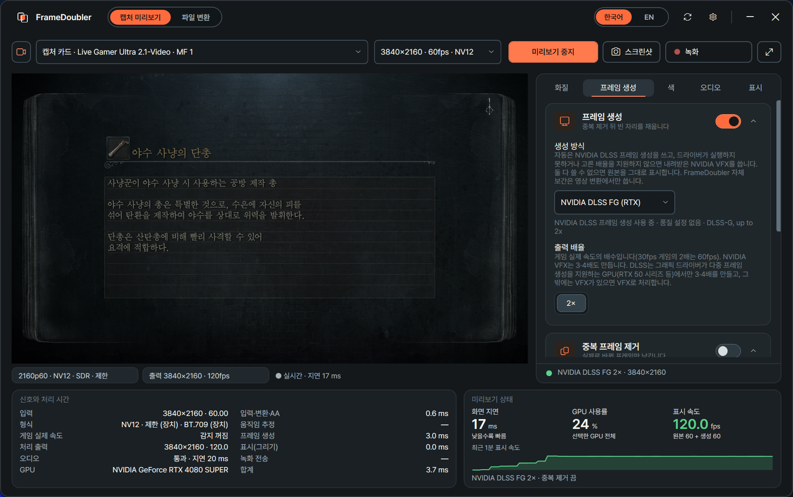
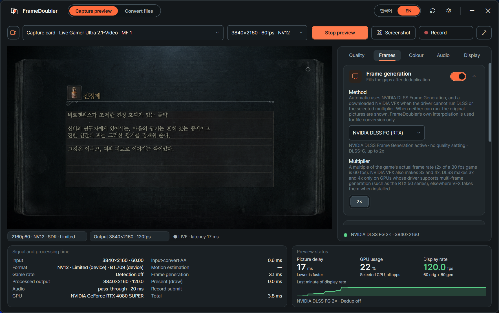
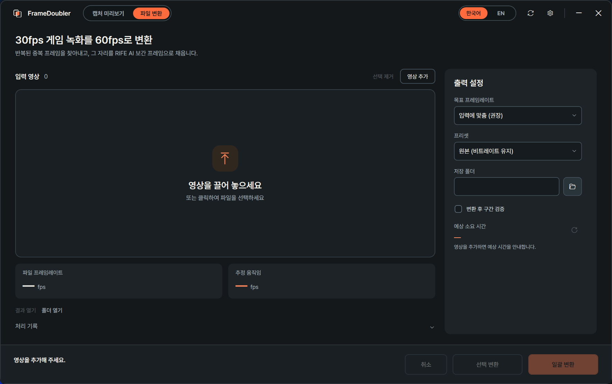
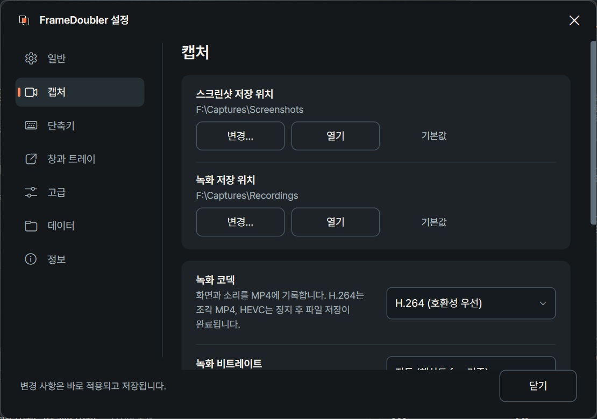
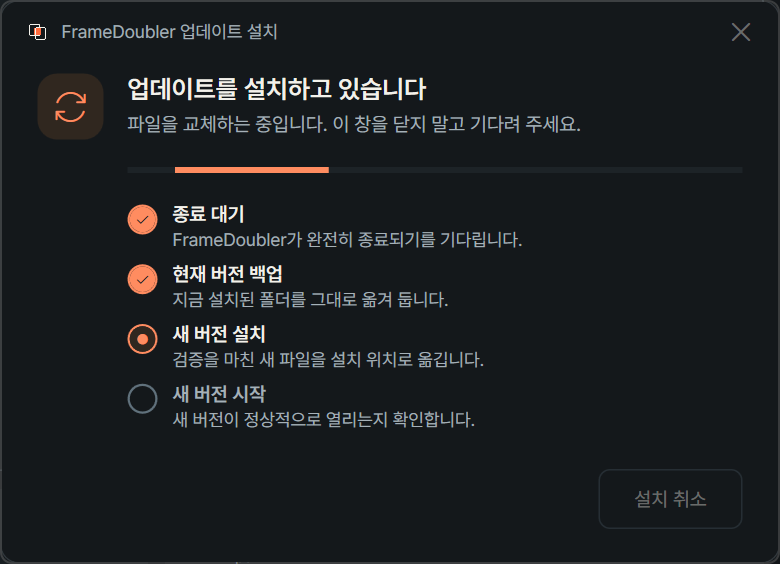

<p align="center">
  
</p>
<h1 align="center">FrameDoubler</h1>
<p align="center">
  <a href="https://github.com/deuxdoom/FrameDoubler/releases/latest"></a>
  <a href="https://github.com/deuxdoom/FrameDoubler/releases"></a>
  
  <a href="LICENSE"></a>
</p>

<p align="center">
  
  
  
</p>

<p align="center"><b>캡처 카드의 게임 화면을 부드럽게 표시·녹화하는 Windows 프로그램</b><br>
실시간 DLSS·VFX 프레임 생성과 RIFE 기반 녹화 파일 변환을 제공합니다.</p>

<p align="center">
  
</p>

<p align="center">
  <a href="https://deuxdoom.github.io/FrameDoubler/"></a>
</p>

<p align="center">
  <a href="#introduction"></a>
  <a href="#compare"></a>
  <a href="#features"></a>
  <a href="#screenshots"></a>
  <a href="#download"></a>
</p>
<p align="center">
  <a href="#usage"></a>
  <a href="#update"></a>
  <a href="#cli"></a>
  <a href="#development"></a>
  <a href="#licenses"></a>
</p>

---

<a id="introduction"></a>

## 📌 소개

캡처 카드를 연결하면 실시간 미리보기에서 화면과 소리를 확인하고 처리 결과를 녹화할 수 있습니다. 제목 표시줄에서 캡처 미리보기와 파일 변환을 전환합니다.

### 실시간 캡처와 녹화

- 앱에 Pretendard JP Variable 글꼴을 포함해 별도 설치 없이 한글·영문·일본어 파일명과 글자를 표시합니다.
- 프레임 생성과 중복 제거는 기본으로 꺼져 있으며, 켜면 저장한 선택을 기억합니다. 중복 제거는 60Hz 신호 속 게임의 실제 프레임을 골라냅니다.
- 자동 프레임 생성은 NVIDIA DLSS FG를 먼저 쓰고, 실행할 수 없거나 선택한 배율을 지원하지 않으면 설치된 NVIDIA VFX를 씁니다. 둘 다 쓸 수 없으면 원본을 표시합니다.
- 기본은 2배이며 VFX는 3·4배도 지원합니다. DLSS는 드라이버가 허용한 배율까지 생성하고, 그 이상은 VFX로 처리하거나 DLSS 최대 배율로 줄입니다. 예를 들어 30fps 게임은 2·3·4배에서 60·90·120fps가 됩니다. VFX는 설정 › 캡처에서 내려받습니다.
- 실시간 캡처는 자체 보간을 쓰지 않습니다. DLSS·VFX 모두 원본 해상도에서 원본과 생성 프레임을 콘텐츠 시각 순서로 표시합니다.
- 프레임 생성 탭의 **DLSS 움직임 보정 · 시험**에서 광학 흐름(NVOF)과 엣지 이지스를 켤 수 있습니다. 기본은 꺼짐이며 VFX에는 적용되지 않습니다. 추가 GPU 시간이 필요하고 경계 흔들림 개선은 장면에 따라 다릅니다. 변경 시 프리뷰가 다시 시작되며 녹화 준비·녹화·저장 중에는 변경할 수 없습니다.
- PNG 스크린샷과 H.264/HEVC·AAC MP4 녹화를 지원합니다. 녹화는 3초 카운트다운 뒤 시작하고 다시 누르면 취소합니다. 영상은 고정 프레임레이트로 저장하며 빈 칸은 직전 그림으로 채웁니다.
- 하단에는 화면 지연(ms), GPU 사용률(%), 실제로 바뀐 프레임의 표시 속도(fps)를 보여 줍니다. 최근 1분의 표시 속도 그래프와 각 수치의 설명도 확인할 수 있습니다.
- 같은 이름의 카드는 장치 경로로 구분해 선택을 기억합니다. Media Foundation에서 열 수 없는 모드는 같은 장치의 DirectShow로 시도하며, 연결이 모호하면 다른 카드로 대체하지 않습니다. NV12·YUY2·UYVY·RGB32·RGB24·I420·YV12 입력을 지원합니다.
- 메인 창은 화면 작업 영역과 Windows 배율에 맞춘 작은 고정 크기입니다. 미리보기를 더블클릭하면 전체 화면으로 전환합니다. HDR 캡처 입력은 아직 지원하지 않습니다.

### 녹화 파일 변환

콘솔 게임이 30fps로 동작하면 캡처 카드는 같은 화면을 두 번씩 받아 60fps 파일로 저장합니다. 파일 정보에는 60fps라고 표시되지만 실제 움직임은 30fps이므로, 유튜브에 올려도 60fps의 부드러움은 나오지 않습니다.

일반적인 보간 프로그램은 이 파일을 그대로 2배로 늘리기 때문에 똑같은 두 프레임 사이를 보간하게 됩니다. FrameDoubler는 먼저 **중복 프레임을 걷어 내어 실제 움직임을 복원**한 뒤에, 남은 프레임 사이를 [Practical-RIFE](https://github.com/hzwer/Practical-RIFE) 모델로 보간합니다.

```
녹화 원본      A  A  B  B  C  C      파일 60fps · 움직임 30fps
FrameDoubler   A  A½ B  B½ C  C½     파일 60fps · 움직임 60fps
```

<a id="compare"></a>

## 🎬 비교 영상

<p align="center">
  <b>◀ 원본 · 움직임 30fps</b>&emsp;&emsp;&emsp;&emsp;<b>FrameDoubler · 움직임 60fps ▶</b><br>
  
</p>

파이어엠블렘 만자천홍의 4K 녹화(60fps)에서 같은 구간을 0.42배 속도(초당 25프레임)로 재생하여 모든 프레임을 보여 줍니다. 왼쪽 원본은 같은 그림이 두 번씩 나오고, 오른쪽 결과는 프레임마다 움직입니다. 실제 속도의 비교는 [소개 페이지](https://deuxdoom.github.io/FrameDoubler/)에서 볼 수 있습니다.

<a id="requirements"></a>

## 💻 시스템 요구 사항

- Windows 11 64비트 (x64)
- Vulkan을 지원하는 GPU와 최신 드라이버 권장 (NVIDIA, AMD, Intel). 제조사나 모델명이 아니라 실제로 동작하는 기능을 확인하여 사용합니다.
- 실시간 프레임 생성은 GPU·드라이버가 지원하는 DLSS 또는 VFX를 사용합니다. 캡처 녹화에는 동작하는 하드웨어 H.264·HEVC 인코더가 필요하며 소프트웨어 녹화로 대체하지 않습니다.
- 파일 변환은 Vulkan을 쓸 수 없으면 CPU로 추론하고, 하드웨어 인코더가 없으면 소프트웨어 인코더를 사용합니다. 이 경우 크게 느려지며 화면에 표시합니다.
- 캡처 입력은 SDR만 지원합니다. 파일 변환은 SDR과 HDR(HLG·PQ) 영상을 지원하며 HDR은 SDR(BT.709)로 출력합니다.
- 다른 캡처 카드는 제조사 드라이버가 Media Foundation 또는 DirectShow로 제공하는 지원 모드에서 사용합니다. DeckLink·Magewell 전용 SDK 입력, 압축 전용 모드와 벤더 전용 오디오는 포함하지 않습니다. 장비별 검증 상태는 [하드웨어 검증](app/HARDWARE-TESTS.md)을 확인하세요.

<a id="features"></a>

## ✨ 주요 기능

### 🔍 입력과 장치 자동 분석

영상을 추가하면 해상도, 코덱, 비트레이트, 길이, 프레임레이트, CFR/VFR, 비트 심도, 색상 정보를 읽습니다. 1~2시간 길이의 녹화도 여러 구간만 읽어 바로 분석합니다. **파일 프레임레이트**와 **실제 움직임 프레임레이트**를 나란히 보여 주므로 이 영상이 어떤 파일인지 바로 알 수 있습니다. 시작할 때에는 이 PC의 CPU, GPU, Vulkan 기능, 인코더를 확인합니다.

### 🎞️ 중복 프레임 감지와 움직임 복원

- 압축 때문에 조금씩 달라진 중복 프레임도 판정합니다.
- 게임이 프레임을 놓쳐 3회, 4회 반복된 구간을 올바르게 처리합니다.
- 일시 정지 메뉴나 로딩 화면 같은 정지 화면은 보간하지 않고 그대로 둡니다.
- 29.97/30fps 원본, 59.94/60fps 파일, VFR 입력을 같은 방식으로 처리합니다.

### ⏱️ 예상 소요 시간

변환하기 전에 선택한 장치와 설정으로 짧게 실제 처리를 해 보고 `약 1시간 05분`처럼 예상 시간 하나와 완료 예정 시각을 보여 줍니다. 추정 범위는 도움말에서 확인합니다. 대기열 전체의 합계도 함께 표시합니다. 같은 조건으로 끝낸 작업이 쌓이면 그 결과로 예상을 보정합니다. 장면, 저장 장치, 다른 프로그램의 부하에 따라 실제 시간은 달라질 수 있습니다.

### 🤖 RIFE AI 보간

- Practical-RIFE 4.25(기본값)와 4.26 모델을 ncnn과 Vulkan으로 실행합니다. 두 모델 모두 프로그램에 들어 있어 따로 내려받을 필요가 없습니다.
- 출력 프레임마다 정확한 시각의 프레임을 만들기 때문에 프레임 드롭 구간도 자연스럽게 채웁니다.
- 장면이 바뀌는 순간에는 보간하지 않아 두 화면이 섞인 프레임이 생기지 않습니다.
- 고정 HUD(미니맵, 자막) 영역을 지정하면 그 화소를 원본 그대로 유지합니다.

### 🎥 인코딩과 검증

- NVENC, AMF, QSV, 소프트웨어 인코더를 짧게 실제로 인코딩해 보고, 성공한 H.264·HEVC·AV1 조합만 메뉴에 보여 줍니다. 추론 GPU와 인코더는 서로 달라도 됩니다.
- **출력 프리셋**: `원본 (비트레이트 유지)`(기본값), `원본 (fps 비례 비트레이트)`, `YouTube 4K`, `YouTube 1080p` 네 가지입니다. 원본 프리셋 둘 다 해상도·가능한 원본 코덱을 유지하고 오디오는 패스스루합니다. 두 번째는 입력 파일 대비 출력 fps 비율만큼 비트레이트를 늘립니다(60fps 파일을 60fps로 변환하면 증가 없음). YouTube는 H.264 High·VBR로 4K 45Mbps·1080p 10Mbps를 쓰며, 오디오는 AAC-LC 48kHz(원본 256kbps 이상: 256kbps, 미만·정보 없음: 192kbps)로 인코딩합니다. HDR 입력은 SDR로 톤 매핑하며 같은 비트레이트를 적용합니다. VBR이므로 실제 평균 비트레이트와 파일 크기는 달라질 수 있습니다.
- 영상 길이와 오디오 시작 시각·싱크를 유지합니다. SDR의 색상 정보를 보존하고 HDR은 SDR로 변환합니다.
- HDR(HLG·PQ) 영상은 톤 매핑하여 SDR(BT.709, 8비트)로 변환합니다. 영상 목록에 `HDR(HLG) → SDR`처럼 표시합니다.
- `변환 후 구간 검증`을 켜면 처음·중간·끝 각 1분의 중복 프레임과 오디오 동기를 검사합니다(최대 3분, 겹침 병합). 전체 메타데이터의 fps·길이·색상·오디오 트랙도 확인합니다. 검사 밖의 오류는 놓칠 수 있으며, 기본으로 꺼져 있습니다. 예상 시간에 이 구간 검증 비용도 반영합니다.
- 보관용으로 119.88fps와 120fps 출력을 선택할 수 있습니다.

### 🧰 편의 기능

- 클릭, 끌어 놓기, `Ctrl+O`로 여러 영상을 추가하고 번호순으로 처리하는 대기열 (대표 장면 썸네일, 끌어서 순서 변경, `일괄 변환`·`선택 변환`)
- 제목 표시줄의 설정(⚙) 버튼: 시작할 때 업데이트 확인, 닫기·최소화 버튼 동작, 고급(추론 장치·인코더·RIFE 모델·고정 HUD), 설정 폴더 열기, 예상 시간 기록 초기화, 작업 파일 정리, 버전·장치 정보
- 프레임리스 창(이동, 크기 조절, 최대화), 접어 둔 처리 기록
- 중복 실행은 새 창을 만들지 않고 기존 창을 앞으로 가져옴. 최소화·트레이·최대화 상태 복원
- 최소화 기본값은 작업 표시줄이며, 설정에서 선택했을 때만 트레이로 보냄. 닫기 동작은 확인·트레이·종료 중 선택
- 메인 창과 같은 색상·아이콘의 트레이 메뉴: 창 열기, 설정, 업데이트 확인, GitHub, 종료
- 종료하거나 비정상 종료되어도 FFmpeg와 보간 엔진 프로세스가 남지 않음
- 같은 이름의 결과 파일은 덮어쓰지 않으며, 취소하거나 실패하면 미완성 파일을 정리
- 한국어와 영어 화면

### 📊 실제 4K 녹화의 검증 결과

| 항목 | 결과 |
| --- | --- |
| 입력 | 파이어엠블렘 만자천홍 녹화, 3840×2160, 60fps, 1,283프레임, 약 21.39초 |
| 추정한 실제 움직임 | 29.81fps |
| 출력 | 60fps, 1,283프레임 (새로 만든 프레임 610장) |
| 남은 움직임 중복 | 0.48% (기준 1% 이하) |
| 길이 차이 / 최대 오디오 동기 변화 | 0ms / 6.83ms |
| 입력 중복 비율 | 50.31% (움직이는 프레임의 절반이 중복) |
| 처리 시간 (기본 Vulkan·검증 해제) | 변환 약 82초, 분석 포함 약 89초 |

처리 시간과 결과는 영상의 내용과 장치에 따라 달라집니다. YouTube 1080p의 10Mbps 설정에서는 복잡한 장면에 압축 흔적이 남을 수 있습니다. 비교 영상과 위 수치는 RIFE 파일 변환 결과이며 실시간 DLSS·VFX 성능 측정이 아닙니다.

<a id="screenshots"></a>

## 🖼️ 화면 모음

| 실시간 영어 화면 | 파일 변환 | 캡처 설정 |
| --- | --- | --- |
|  |  |  |

<a id="download"></a>

## 📥 내려받기와 실행

1. [ZIP 내려받기](https://github.com/deuxdoom/FrameDoubler/releases/download/v2.0.0/FrameDoubler_v200.zip)로 `FrameDoubler_v200.zip`(약 264MB)을 받습니다. 1.0.2부터 ZIP 이름에 버전이 들어갑니다. 버전과 SHA-256은 [릴리스 정보](https://github.com/deuxdoom/FrameDoubler/releases/latest)에서 확인합니다.
2. 원하는 위치에 압축을 풉니다. 풀린 `FrameDoubler` 폴더(약 536MB)는 통째로 유지합니다. 폴더에는 `FrameDoubler.exe`, `FrameDoubler.Cli.exe`와 .NET 런타임이 든 `dll` 폴더가 있습니다.
3. `FrameDoubler.exe`를 실행합니다.

.NET 런타임, RIFE 모델, FFmpeg가 모두 들어 있어 Python, CUDA Toolkit, 별도 SDK를 설치할 필요가 없습니다. GPU 드라이버는 포함하지 않습니다. 파일의 SHA-256은 릴리스 설명에 적혀 있습니다.

```powershell
Get-FileHash FrameDoubler_v200.zip -Algorithm SHA256
```

<a id="usage"></a>

## 🚀 사용 방법

### 캡처 미리보기와 녹화

1. 캡처 카드를 연결하고 장치·입력 모드를 확인합니다. 지원 모드가 있으면 자동으로 미리보기를 시작합니다.
2. 필요하면 `중복 프레임 제거`와 `프레임 생성`을 켭니다. 60Hz 신호의 30fps 게임은 중복 제거와 2배 생성을 함께 사용합니다.
3. `녹화`를 누르면 3초 뒤 시작합니다. 다시 누르면 저장을 마무리합니다. `스크린샷`은 원본 해상도 PNG를 저장합니다. 저장 위치·코덱은 설정 › 캡처에서 바꿉니다.

미리보기를 더블클릭하거나 F11을 눌러 전체 화면으로 전환합니다. 기본 단축키는 F7 스크린샷·F8 녹화·F6 프레임 생성·F10 통계·V 원본 비교이며 설정 › 단축키에서 바꿉니다.

### 녹화 파일 변환

1. 영상을 창에 끌어 놓거나 가운데 영역을 클릭합니다. `영상 추가`와 `Ctrl+O`도 사용할 수 있습니다. 추가하면 바로 분석합니다.
2. 파일 fps와 실제 움직임 fps를 확인하고, 목표 프레임레이트·프리셋·저장 폴더를 고릅니다. 저장 폴더를 비워 두면 원본과 같은 폴더에 저장합니다.
3. `예상 소요 시간`을 확인하고 `일괄 변환`(목록 번호순으로 모두) 또는 `선택 변환`(고른 영상만)을 누릅니다. 목록의 영상은 끌어서 순서를 바꿀 수 있고, `Ctrl`·`Shift`로 여러 개를 고를 수 있습니다. 끝나면 `결과 열기` 또는 `폴더 열기`를 누릅니다. 결과를 검사하려면 `변환 후 검증`을 켜 둡니다.

| 입력 | 기본 출력 (`입력에 맞춤`) |
| --- | --- |
| 29.97fps | 59.94fps |
| 30fps | 60fps |
| 59.94fps (움직임 30fps) | 59.94fps |
| 60fps (움직임 30fps) | 60fps |

영상·오디오 인코딩 값은 네 가지 프리셋으로 정하고, 추론 장치, 인코더, RIFE 모델, 고정 HUD는 설정(⚙)의 `고급`에서 바꿉니다. YouTube 프리셋은 60fps까지이며 120fps 출력은 두 원본 프리셋에서 선택합니다. 닫기 버튼을 누르면 종료할지 확인합니다. 종료하면 진행 중인 작업을 취소하고 미완성 파일과 처리 프로세스를 정리합니다. 설정의 `창과 트레이`에서 닫기·최소화 버튼이 트레이로 최소화하도록 정하면 작업이 트레이에서 계속됩니다.

설정(`settings.ini`), 성능 기록(`performance.json`), 작업 파일(`work`)은 모두 `FrameDoubler.exe`가 있는 폴더에 저장합니다. 폴더를 통째로 옮겨도 설정이 그대로 이어집니다. `settings.ini`는 UTF-8 텍스트이며, 1.0.1까지 쓰던 `settings.json`은 처음 실행할 때 한 번 `settings.ini`로 옮깁니다.

<a id="update"></a>

## 🔄 업데이트

시작할 때 GitHub의 안정 릴리스를 확인하고, 새 버전이 있으면 제목 표시줄의 업데이트 버튼(⟳)을 주황색으로 표시합니다. 버튼이나 트레이 메뉴의 `업데이트`를 누르면, 최신 버전일 때는 작은 창으로 알려 주고 새 버전이 있을 때만 변경 사항과 설치 단계(다운로드 → 무결성 확인 → 설정 보존 → 재시작·설치)를 보여 주는 창을 엽니다.

- 해당 버전의 이름(예: `FrameDoubler_v200.zip`)과 다운로드 주소가 정확히 맞고 GitHub가 제공하는 SHA-256이 있는 파일만 설치합니다. 릴리스 설명에 SHA-256이 적혀 있으면 서로 일치해야 합니다.
- 내려받은 뒤 패키지의 매니페스트와 모든 파일의 해시를 확인합니다. 설치는 설치 폴더 옆에 복사한 별도 설치 프로그램이 맡으며, 이 프로그램이 패키지를 다시 확인하고 준비를 마친 뒤에만 FrameDoubler가 종료됩니다.
- FrameDoubler가 완전히 종료되면 설치 창이 나타나 이전 설치를 백업으로 옮기고 새 버전을 넣습니다. 파일이 잠시 사용 중이면 최대 30초 동안 다시 시도합니다.
- 새 버전이 열려 시작을 확인해야 설치가 끝납니다. 교체나 시작에 실패하면 이전 설치로 되돌리고 다시 엽니다. 결과는 설치 창과 `work/updates/last-install.json`에 남습니다.
- 설정과 성능 기록은 새 버전으로 옮깁니다. 설치 폴더 옆에는 가장 최근의 백업(`FrameDoubler.previous-…`) 하나만 남깁니다.
- 1.0.2 이상은 버전 ZIP으로 자동 업데이트합니다. 1.0.0과 1.0.1의 자동 업데이트는 `FrameDoubler.zip`이라는 이름의 파일만 찾습니다. 릴리스에 그 이름의 파일이 없으면 위 링크에서 새 ZIP을 받아 새 폴더에 풀고, 이전 폴더의 `settings.json`과 `performance.json`을 새 폴더로 복사합니다.



<a id="cli"></a>

## ⌨️ 명령줄

같은 폴더의 `FrameDoubler.Cli.exe`는 화면과 같은 변환 과정을 사용합니다.

```text
FrameDoubler.Cli hardware                                   이 PC의 장치와 인코더
FrameDoubler.Cli analyze video.mp4                          형식, 비트레이트, 실제 움직임 fps
FrameDoubler.Cli estimate video.mp4 --preset source          예상 소요 시간 (--verify: 검증 포함)
FrameDoubler.Cli run -i video.mp4 -o smooth.mp4 --preset youtube-2160
FrameDoubler.Cli run -i video.mp4 --preset youtube-1080           (source, source-scaled, youtube-2160)
FrameDoubler.Cli run -i video.mp4 --device gpu:1 --encoder qsv --codec hevc
FrameDoubler.Cli run -i video.mp4 --device cpu --software --codec h264
FrameDoubler.Cli run -i video.mp4 --fps 120 --model v4.26
FrameDoubler.Cli verify video.mp4 smooth.mp4 --fps 60
FrameDoubler.Cli batch recordings -o converted --recursive
```

`--overwrite`는 기존 파일의 교체를 허용하고, `--no-verify`는 검증을 건너뜁니다(명령줄의 `run`은 기본으로 검증합니다). `--hud-region X,Y,W,H`는 여러 번 지정할 수 있으며, `--quality 1..51` 또는 `--bitrate 24M`으로 화질을 정합니다. 자세한 내용은 [실행 안내](app/README.md)에 있습니다.

<a id="development"></a>

## 🛠️ 개발 환경

Windows 11 x64, `global.json`의 .NET SDK(10.0.404)와 외부 CMake/Ninja·LLVM-MinGW·ncnn 소스를 사용합니다.

```powershell
pwsh scripts/setup-dev.ps1                                    # 빌드 도구 준비
dotnet run --project app/FrameDoubler.Tests                   # 테스트
pwsh scripts/build.ps1                                        # dist/FrameDoubler와 버전 ZIP(dist/FrameDoubler_v200.zip) 생성
```

빌드 도구는 프로젝트의 `tools/dev`, 중간 파일은 `build`에 두며 저장소에는 포함하지 않습니다. 모델의 최초 변환에만 필요한 최소 Python 코드는 [`poc/ncnn-rife`](poc/ncnn-rife/README.md)에 격리했으며 제품에는 포함하지 않습니다. 변경 내역은 [CHANGELOG.md](CHANGELOG.md)에 있습니다.

<a id="licenses"></a>

## 📄 출처와 라이선스

FrameDoubler는 [MIT 라이선스](LICENSE)로 배포하는 독립 프로젝트입니다. Video2X와 Flowframes는 기술 분석의 참고 자료일 뿐이며, 소스 코드나 모델 자산을 복사하거나 이식하지 않았습니다.

- 프레임 보간: [Practical-RIFE](https://github.com/hzwer/Practical-RIFE)의 공식 가중치를 ncnn 형식으로 변환 (MIT, Copyright (c) 2021 hzwer)
- 추론: [Tencent ncnn](https://github.com/Tencent/ncnn) (BSD-3-Clause)과 glslang
- 앱: Microsoft .NET / Windows Desktop 런타임 (MIT)
- 디코딩과 인코딩: [FFmpeg](https://ffmpeg.org) (BtbN LGPL 빌드, 교체 가능한 별도 실행 파일)

구성 요소별 고지는 [THIRD_PARTY_NOTICES.md](THIRD_PARTY_NOTICES.md)에 있습니다. 비교 영상은 개발자가 직접 녹화한 게임 화면이며, 게임 화면의 저작권은 해당 권리자에게 있습니다.
